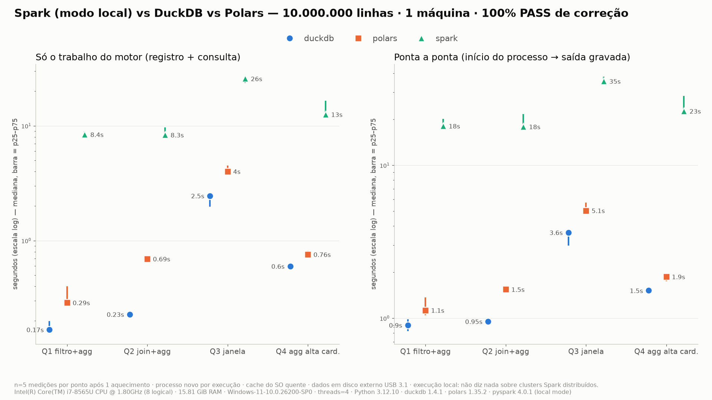

# Spark vs DuckDB vs Polars — o mais rápido nem sempre é o melhor

**Um benchmark reproduzível em que a correção é verificada antes de qualquer medição de tempo.**

> **Escopo:** uma única máquina (notebook). O Spark roda em modo local (`local[4]`).
> **Nada aqui diz respeito ao desempenho de um cluster Spark distribuído.**



---

## 1. O problema

Times de dados querem reduzir custo e latência dos pipelines analíticos. A pergunta mais comum é *"qual motor é mais rápido?"*. Antes dela vem outra, mais importante:

> **Os motores estão devolvendo a mesma resposta?**

Se um motor é 10× mais rápido mas trata `NULL` de outro jeito, o "ganho" é um bug em produção. Um benchmark que não verifica correção pode recomendar a ferramenta errada, e essa decisão costuma durar anos.

## 2. O ponto de partida

O projeto começou de um laboratório simples (`benchmark_spark_duckdb_polars.zip`, preservado intacto em [`original/`](original/)): um script com 4 consultas de varejo sobre Parquet, executadas em Spark, DuckDB e Polars. A documentação dizia que o código só tinha passado por verificação de sintaxe.

Antes de medir qualquer coisa, **auditei o código inteiro e executei** a versão original. Os achados estão em [docs/AUDIT.md](docs/AUDIT.md). Os principais:

| O que encontramos | Por que importa |
|---|---|
| O projeto **não rodava**: a geração de dados falhava na versão fixada do DuckDB | Os números nunca poderiam ter sido reproduzidos |
| Se o Spark falhasse, o harness **travava para sempre** (deadlock de pipe no Windows) | Um erro virava um "benchmark lento" que nunca termina |
| O "oráculo" de correção era o **próprio DuckDB, comparado consigo mesmo** | Um erro do DuckDB nunca seria detectado |
| Só a **última** repetição era validada | Execuções erradas anteriores passavam despercebidas |
| O Polars somava um grupo **só com NULL como 0**, enquanto o SQL devolve NULL | Diferença de semântica que muda o resultado de negócio |
| O Polars ordenava **NULL primeiro** na consulta de janela | Escolhia a "última compra" errada |
| Os dados não tinham NULL, órfãos no join nem estornos | Por isso, **nenhum desses bugs aparecia**: o benchmark dizia "tudo certo" |

Os três bugs de semântica estão comprovados por testes automatizados (`tests/test_correctness.py::test_original_*`).

> **Lição:** um benchmark com dados "bonitos demais" pode passar em todas as validações e ainda assim estar errado.

## 3. O que decidimos testar, e por quê

Com base nesse contexto, o objetivo deixou de ser "quem é mais rápido" e passou a ser **"quem é mais rápido *entregando a mesma resposta correta*, e em quais condições"**.

| Decisão | Motivo |
|---|---|
| **Correção é bloqueante.** Qualquer divergência vira FAIL, e FAIL não entra em gráfico | Velocidade de um resultado errado não tem valor |
| **Referência independente** em Python puro (sem SQL), mais **SQLite** como segunda opinião | Não usar nenhum dos motores avaliados como juiz |
| **Casos de borda com resposta escrita à mão antes de rodar**: NULL, duplicatas, empates, IDs órfãos no join, valores negativos e zero, datas-limite, cardinalidade extrema | São exatamente os casos em que os motores divergem |
| **Dados sintéticos com seed fixa**, com esses casos de borda dentro do dataset principal | Qualquer pessoa gera os mesmos dados e confere pelo hash |
| **As mesmas 4 consultas de negócio** do original: filtro, join, janela e agregação de alta cardinalidade | Preservar a comparação com o ponto de partida |
| **Três escalas**: 10 mil, 1 milhão e 10 milhões de linhas | Ver se a ordem dos motores muda com o volume |
| **Spark em modo local** no comparativo principal | Comparação justa na mesma máquina. Cluster é outro experimento |
| **Separar inicialização de trabalho do motor** | O Spark paga uma inicialização da JVM; é preciso ver quanto disso é custo fixo |

As regras exatas (NULL, desempate, tipos, timezone) estão em [docs/SEMANTICS.md](docs/SEMANTICS.md).

## 4. Como testamos

1. **Gerar** os dados (`data_generator/`) com seed fixa. O manifesto registra o hash do conteúdo.
2. **Calcular a resposta certa** com a referência independente (`src/bench/reference.py`).
3. **Executar** cada motor × consulta num **processo novo**: 1 aquecimento + 5 medições, com a ordem dos motores alternada a cada rodada.
4. **Validar cada execução medida**: esquema, contagem, conjunto de chaves, hash canônico, valores exatos e invariantes (por exemplo, "linhas casadas + linhas órfãs = total" no join).
5. **Medir por fase**: inicialização, consulta e escrita, além do tempo total. Também pico de memória e CPU da árvore de processos.
6. **Relatar** mediana e p25–p75. Nenhum ranking mistura consultas diferentes. Tabelas e gráficos são gerados por script.

Também protegemos o experimento contra o ambiente: uma execução que atravessa uma suspensão do Windows é invalidada, e uma checagem de RAM livre impede medir sob pressão de memória. Dados, temporários e spill ficam no mesmo disco do projeto.

## 5. Resultados

**Correção: 270 de 270 execuções com PASS** (3 motores × 5 consultas × 3 escalas × 6 execuções: 1 aquecimento + 5 medições; ou seja, 225 medições e 45 aquecimentos, todos validados), mais 65 testes automatizados. Só a partir daí os tempos foram comparados.

<!-- RESULTADOS:INICIO (gerado por report.py) -->

**Escala extension: 10.000.000 linhas** · mediana de 5 medições após 1 aquecimento · só execuções com PASS de correção

| Consulta | DuckDB | Polars | Spark (local) | Mais rápido |
|---|---|---|---|---|
| Q1 filtro + agregação | 0.17 s | 0.29 s (1.7×) | 8.40 s (50.1×) | duckdb |
| Q2 join + agregação | 0.23 s | 0.69 s (3.0×) | 8.33 s (36.6×) | duckdb |
| Q3 janela (última compra) | 2.46 s | 4.00 s (1.6×) | 25.73 s (10.5×) | duckdb |
| Q4 agregação alta cardinalidade | 0.60 s | 0.76 s (1.3×) | 12.55 s (21.0×) | duckdb |

Tempo = **trabalho do motor** (registrar a fonte + executar a consulta + materializar o resultado), sem contar a inicialização do processo. Entre parênteses: quantas vezes mais lento que o mais rápido **na mesma consulta**.

- Inicialização da sessão Spark (JVM + SparkSession), paga **a cada execução** em modo local: ~8.5 s (mediana).
- Pico de memória da árvore de processos (maior mediana entre as consultas): duckdb ~532 MiB, polars ~1456 MiB, spark ~2450 MiB.

Tabelas completas (todas as escalas, p25/p75, ponta a ponta, CPU): [results/key_results.md](results/key_results.md) e [results/summary_table.md](results/summary_table.md).

<!-- RESULTADOS:FIM -->

**Ambiente:** Intel i7-8565U (4 núcleos / 8 threads, notebook), 16 GB de RAM, Windows 11, dados em disco externo USB 3.1, 4 threads por motor. Versões fixadas em [`requirements.lock`](requirements.lock). Manifesto completo em `results/<escala>/environment.json`.

Gráficos por escala (latência, memória, throughput) em [`results/charts/`](results/charts/).

## 6. O que podemos concluir (e o que não podemos)

**Podemos concluir, para esta máquina, até 10M linhas e estas 4 consultas:**
- **Os três motores chegaram à mesma resposta exata** depois que a semântica foi explicitada. A correção foi uma questão de *especificar* bem, e nenhum motor estava "errado".
- **DuckDB e Polars ficaram na mesma ordem de grandeza**, e nenhum venceu tudo: o DuckDB liderou em 10M, mas o Polars venceu a agregação de alta cardinalidade em 1M ([results/key_results.md](results/key_results.md)).
- **No Spark em modo local, o custo fixo de inicialização pesa muito** em jobs curtos. Mesmo descontado esse custo, ele foi o mais lento em todas as consultas e escalas medidas, e usou mais memória.
- **A consulta de janela (Q3) é a mais cara** para todos, e é onde a diferença relativa do Spark é menor.

**Não podemos concluir:**
- Nada sobre **Spark em cluster**, nem sobre dados **maiores que a RAM**. Esse é o cenário para o qual o Spark foi feito.
- Nada sobre **Spark com sessão já aquecida** (notebook ou serviço), que elimina o custo de inicialização.
- Nada sobre **custo de nuvem**, governança ou operação. Nenhum preço foi estimado.
- Que algum motor seja "o melhor" em geral.

A lista completa de limitações e a matriz de decisão estão em [docs/RESULTS.md](docs/RESULTS.md).

## 7. O valor disso para o futuro

- **Um método, não um ranking.** O mesmo harness serve para avaliar uma nova versão de motor, um novo formato (Delta/Iceberg) ou uma consulta do seu negócio: troque a consulta, mantenha a validação.
- **Proteção contra migrações erradas.** Antes de trocar Spark por DuckDB ou Polars (ou o contrário), rode as *suas* consultas aqui. Se a resposta mudar, você descobre antes da produção.
- **Testes de regressão de semântica.** As fixtures de borda viram uma suíte permanente: se uma atualização mudar como um motor trata NULL ou desempates, o teste quebra.
- **Base para os próximos experimentos**, que respondem perguntas que este não responde:
  1. Spark com sessão aquecida e em cluster, com custo documentado;
  2. 100M+ linhas e dados maiores que a RAM (spill);
  3. outra máquina (Linux, SSD NVMe) para checar se as conclusões se mantêm;
  4. consultas e distribuições reais (skew, strings longas).

## 8. Reproduza você mesmo

**Requisitos:** Python 3.11–3.13 (testado: 3.12.10) e Java 17+ (testado: Temurin 17.0.21; o ZIP do JDK funciona sem admin). Para 10M, ~9 GiB de RAM livre. Os datasets não são versionados: são gerados localmente.

### Windows (PowerShell)
```powershell
py install 3.12                                          # se ainda não tiver
$env:JAVA_HOME="$env:USERPROFILE\tools\jdk-17.0.21+9"    # JDK 17 extraído
.\scripts\setup_env.ps1
.\scripts\run_all.ps1                    # testes (bloqueantes) -> 10k -> 1M -> 10M -> relatório
.\scripts\run_all.ps1 -Scales smoke      # só o teste rápido (10k)
```
### Linux / macOS
```bash
export JAVA_HOME=/caminho/para/jdk-17
bash scripts/setup_env.sh
bash scripts/run_all.sh                  # ou: bash scripts/run_all.sh smoke
```
### Comandos individuais (com `PYTHONPATH=src` e o venv ativo)
```bash
python -m pytest -rs                                     # correção: comando único
python -m bench.cli run --scale smoke                    # dados + referência + 1 aquecimento + 5 medições
python -m bench.cli run --scale baseline --engines duckdb polars --queries q1 q2
python -m bench.cli report                               # estatísticas, gráficos e a tabela deste README
python -m bench.cli env                                  # manifesto do ambiente
```

## 9. Estrutura do repositório
```
configs/benchmark.json      threads, rodadas, escalas e configuração dos motores (fonte única)
data_generator/generate.py  gerador determinístico (seed fixa) + manifesto com hash do conteúdo
src/bench/queries.py        SQL, esquemas de saída e implementação Polars (fonte da verdade)
src/bench/reference.py      referências independentes: Python puro e SQLite
src/bench/validate.py       esquema, contagem, chaves, hash canônico, valores exatos, invariantes
src/bench/worker.py         1 motor × 1 consulta em processo novo, com tempo por fase
src/bench/runner.py         orquestração, amostragem de memória/CPU, validação de cada execução
src/bench/report.py         estatísticas, gráficos e a tabela de resultados deste README
tests/                      casos de borda com resposta escrita à mão + testes do próprio validador
results/                    dados brutos (runs.csv), validation.json, ambiente, gráficos, resumos
docs/                       AUDIT (auditoria), SEMANTICS (regras), RESULTS (limitações e decisões)
original/                   ZIP original intacto · original_minpatch/: cópia com patch mínimo, só para diagnóstico
```

## 10. Troubleshooting
| Sintoma | Causa / solução |
|---|---|
| `Invalid Spark URL: spark://HeartbeatReceiver@MEU_HOST` | Hostname com `_`. Use `SPARK_LOCAL_HOSTNAME=localhost` (os scripts já fazem isso). |
| `WARN Shell: Did not find winutils.exe` | Inofensivo aqui: o Spark só **lê** Parquet; a saída é gravada pelo pyarrow. |
| Mensagens "ÊXITO: o processo … foi finalizado" | É o `taskkill` do pyspark no Windows. O harness não depende do stdout. |
| `java` não encontrado | Defina `JAVA_HOME`. O MSI do winget pede admin; o ZIP do JDK não. |
| `pip` não encontra wheel | Use Python 3.11–3.13. |
| `PRE-FLIGHT: only X GiB RAM available` | Feche outros aplicativos ou ajuste `min_available_ram_gib` em `configs/benchmark.json` e documente a mudança. |
| `WinError 1455` (arquivo de paginação muito pequeno) | Memória virtual do Windows esgotada: feche aplicativos ou aumente o pagefile (exige admin). |
| Suspensão do Windows durante a execução | O runner impede a suspensão por inatividade; execuções suspensas são invalidadas. Não feche a tampa do notebook. |
| Git: `detected dubious ownership` em disco exFAT | `git config --global --add safe.directory <caminho>` (só para a pasta do projeto). |
| OOM no Spark em escalas maiores | Ajuste `spark.driver.memory` em `configs/benchmark.json` e registre a mudança. |

**Docker:** não incluído. Em container, a performance muda (cgroups, overlay FS, I/O virtualizado), e os resultados não seriam comparáveis aos daqui.

---
Inspiração: Jacob Verhoeks, ["Half the bugs were in the benchmark"](https://jacob.verhoeks.org/blog/2026-11-04-half-the-bugs-were-in-the-benchmark/) (4/nov/2026).
